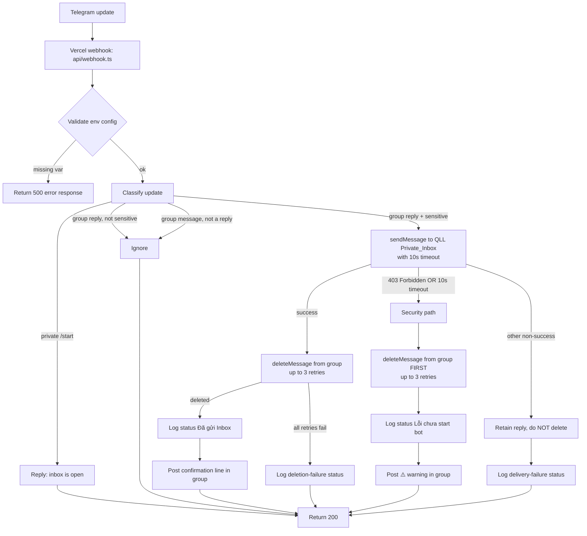

# Design Document

## Overview

The Telegram Account Relay Bot is a stateless serverless function that protects sensitive account credentials (Tài khoản / Mật khẩu) shared inside a working group. When a collaborator (CTV) replies to a manager's (QLL) account request with credential information, the bot relays the exact credential text to the QLL's private inbox, removes the sensitive reply from the group, logs the exchange to Supabase, and posts a non-sensitive confirmation line in the group.

The bot is delivered as a single Vercel Serverless Function written in TypeScript at `api/webhook.ts` (satisfies Requirement 9.1). There is no web user interface — the function processes Telegram update payloads entirely within that one endpoint (satisfies Requirement 9.2). Vercel hosts the function so it is reachable 24/7, and Telegram pushes updates to it over HTTPS via a configured webhook rather than the bot polling for updates.

The bot has two external dependencies:

- **Telegram Bot API** — reached over native `fetch` (HTTPS). Only two methods are used: `sendMessage` (deliver credentials to the inbox, post confirmations/warnings in the group) and `deleteMessage` (remove the sensitive reply from the group).
- **Supabase** — reached through `@supabase/supabase-js`. The bot writes shift-history rows into the pre-existing table `bot_account_logs`. The bot assumes the table already exists and never runs a schema migration (satisfies Requirement 9.3).

All secrets are supplied through environment variables — `BOT_TOKEN`, `SUPABASE_URL`, `SUPABASE_KEY` — and nothing is hard-coded (satisfies Requirement 8.1). A `.env.example` enumerates these variables (satisfies Requirement 8.2). If any required variable is missing at runtime, the webhook returns an error response (satisfies Requirement 8.3). All user-facing bot strings are Vietnamese and are reproduced byte-for-byte in this design.

## Architecture

### Request flow

The function receives one Telegram update per invocation, classifies it, and runs the relay flow when the update is a sensitive group reply. The critical ordering is: deliver to the private inbox **first**, and only delete the group reply **after** delivery is confirmed — so credentials are never removed from the group before they reach the QLL (except on the 403 / timeout security path, where deletion still happens to protect the credentials).



### Update-classification decision logic

The handler inspects each update and selects exactly one branch. Only the first case produces a private reply; only the second case triggers the relay flow; the remaining cases are no-ops.

| # | Condition | Action |
|---|-----------|--------|
| a | Message in a **private** chat whose text is the `/start` command | Reply in that private chat acknowledging the inbox is open (satisfies Requirement 6.1) |
| b | Message in the group that **is a reply** AND whose text contains Sensitive_Content | Run the relay flow: inbox → delete → log → confirm (satisfies Requirements 2, 3.1, 3.2) |
| c | Message in the group that **is a reply** but is **NOT** sensitive | Ignore — no deletion, relay, or logging (satisfies Requirement 3.3) |
| d | Message in the group that is **NOT a reply** | Ignore — no deletion, relay, or logging (satisfies Requirement 5.1) |

A non-sensitive request posted by the QLL themselves falls under case (d) or (c) and is left visible (satisfies Requirement 1.1).

### Critical action ordering

For a sensitive group reply (case b), the sequence is strict:

1. **Send to inbox first.** Call `sendMessage` to the QLL's private inbox with an inbox payload composed of the QLL's own request followed by the exact Sensitive_Content — specifically `📩 Yêu cầu của bạn: <request text>\n\n<Sensitive_Content>` — wrapped in a 10-second timeout (satisfies Requirements 2.1, 2.7, 10.2). When the replied-to request has no text, only the exact Sensitive_Content is sent, with no prefix line. The Sensitive_Content portion is included byte-for-byte; the only text the handler adds is the fixed prefix, the request text, and the blank-line separator. On the success path, the handler issues the `deleteMessage` request immediately after inbox delivery is confirmed, within the same webhook invocation (satisfies Requirement 10.2). On the security path (403 / timeout) it issues the `deleteMessage` without waiting on inbox confirmation at all.

   **Timing precedence (resolves the Req 2.2 vs Req 10.1 conflict).** Requirement 2.2 requires that a reply is deleted only *after* confirmed inbox delivery, and Requirement 10.1 targets issuing the delete within 500 ms of receiving the update. These two cannot both hold on the success path when Telegram's own `sendMessage` round-trip to the inbox takes longer than 500 ms — and credentials must never be removed from the group before the QLL can receive them. The authoritative resolution is: **confirmed-delivery-before-delete (Req 2.2) always takes precedence**, so on the success path the receipt-relative 500 ms of Req 10.1 is a **best-effort target bounded by Telegram's upstream send latency, not a hard guarantee** the handler can meet when the upstream send is slow. What the handler *does* guarantee on the success path is that the delete is issued *promptly* once delivery confirms — in the same webhook invocation, with no added wait and never blocked behind the remaining 10-second timeout budget. On the security path, where there is no delivery to wait for, the delete is issued immediately (comfortably within 500 ms of receipt), so Req 10.1 is met there as written.
2. **Delete only after confirmed delivery.** On a confirmed success response, delete the reply from the group (satisfies Requirement 2.2), then log "Đã gửi Inbox" (satisfies Requirements 2.5, 7.7) and post the confirmation line as a Telegram reply to the QLL Request_Message so the QLL is notified (satisfies Requirement 2.6).
3. **Security path on failure to deliver.** If `sendMessage` returns **403 Forbidden**, or if it does not respond within **10 seconds** (the timeout is treated as a failure identical to 403), the bot still deletes the reply from the group **before** posting any warning, to protect the credentials (satisfies Requirements 4.1, 4.5). It then logs the status `"Lỗi chưa start bot"` (satisfies Requirement 4.2) and posts the warning (satisfies Requirement 4.3):

   > ⚠️ Đã ẩn thông tin! QLL cần bấm /start ở khung chat riêng với Bot để nhận Inbox.

4. **Non-403 delivery failure.** If `sendMessage` returns a non-success response that is not a 403, the reply is **retained** (not deleted) and a delivery-failure status is logged (satisfies Requirement 2.3).

### Telegram webhook setup notes

These are one-time operational steps outside the code. They are documented here so deployment is reproducible:

- **setWebhook** — register the function URL with Telegram so updates are pushed to `https://<deployment>/api/webhook`. Call `https://api.telegram.org/bot<BOT_TOKEN>/setWebhook?url=<deployment>/api/webhook`.
- **BotFather `/setprivacy` → Disable** — group privacy mode must be disabled so the bot receives all group messages (including replies it did not author), not only commands and @mentions.
- **Group admin with "Delete messages" right** — the bot must be an administrator of the Shared_Group with permission to delete messages, otherwise `deleteMessage` fails.
- **QLL must `/start` the bot once** — Telegram forbids a bot from messaging a user who has never opened a chat with it. Until the QLL sends `/start`, `sendMessage` to that user returns 403, which drives the security path above.

## Components and Interfaces

The code is split into one entry point plus small single-responsibility modules under `lib/`. Each module is independently unit-testable, and the Telegram and Supabase modules are the only ones that touch the network.

### `api/webhook.ts` — entry point

Responsibility: HTTP boundary. Parse the incoming Telegram update, validate env config, route to the handler, and return quickly to Telegram.

- Reads the request body as a Telegram `Update`.
- Calls `loadConfig()`. If it throws (missing var), responds with a 500/error — this is a hard config error (satisfies Requirement 8.3).
- Delegates to `handleUpdate(update, deps)`.
- **Always returns HTTP 200** for handled message-processing outcomes — including handled errors like a failed delete or a Supabase insert failure — so Telegram does not re-deliver the same update and cause a retry storm. The only responses that are not 200 are hard config errors.

```typescript
export default async function handler(
  req: VercelRequest,
  res: VercelResponse
): Promise<void>;
```

### `lib/config.ts` — environment configuration

Responsibility: read and validate the required environment variables.

```typescript
export interface Config {
  botToken: string;
  supabaseUrl: string;
  supabaseKey: string;
}

// Throws Error if BOT_TOKEN, SUPABASE_URL, or SUPABASE_KEY is missing/empty.
export function loadConfig(): Config;
```

`loadConfig` reads `process.env.BOT_TOKEN`, `process.env.SUPABASE_URL`, `process.env.SUPABASE_KEY` and throws a descriptive error naming the first missing variable (satisfies Requirements 8.1, 8.3).

### `lib/telegram.ts` — thin typed Telegram wrapper

Responsibility: all Telegram Bot API calls over native `fetch`, plus error classification, timeout, and delete retries.

```typescript
export interface TelegramClient {
  sendMessage(chatId: number, text: string, replyToMessageId?: number): Promise<SendResult>;
  deleteMessage(chatId: number, messageId: number): Promise<DeleteResult>;
}

export type SendResult =
  | { ok: true; messageId: number }
  | { ok: false; forbidden: boolean; description: string };

export type DeleteResult = { ok: true } | { ok: false; description: string };

export function createTelegramClient(botToken: string): TelegramClient;

// Rejects with a TimeoutError if the promise does not settle within ms.
export function withTimeout<T>(p: Promise<T>, ms: number): Promise<T>;

// Retries deleteMessage up to `attempts` times (default 3) until it succeeds.
export function deleteWithRetry(
  client: TelegramClient,
  chatId: number,
  messageId: number,
  attempts?: number
): Promise<DeleteResult>;
```

- `sendMessage` POSTs to `/bot<token>/sendMessage`. It classifies the response: a Telegram payload with `ok: false` and `error_code: 403` sets `forbidden: true` so the handler can take the security path (satisfies Requirements 4.1, 4.2, 4.3).
- `withTimeout` is used to wrap the inbox `sendMessage` with a 10-second budget; a timeout is surfaced as a failure the handler treats identically to a 403 (satisfies Requirement 4.5).
- `deleteWithRetry` wraps `deleteMessage` with up to 3 attempts, used on both the success path and the security path (satisfies Requirements 2.4, 4.4).

### `lib/detector.ts` — sensitive-content detection

Responsibility: decide whether a message text is sensitive.

```typescript
export function isSensitive(text: string): boolean;
```

`isSensitive` returns `true` when **either** rule matches:

1. **Keyword match (satisfies Requirement 3.1).** The text is normalized for comparison by applying Unicode `NFD` normalization and stripping combining marks (`/[\u0300-\u036f]/g`) to remove diacritics, then lowercased. The normalized text is tested against the keyword list, matched case-insensitively and diacritic-insensitively. Keyword list (normalized forms):
   - `tk`
   - `mk`
   - `tai khoan` (from "Tài khoản")
   - `mat khau` (from "Mật khẩu")
   - Colon-suffixed variants are covered because the colon and surrounding whitespace do not break a substring match on the base keyword; the detector also explicitly accepts `tk:` and `mk:` forms. For the short tokens `tk` / `mk`, a word-boundary-aware regex (`/\b(tk|mk)\b[: ]?/`) is used so arbitrary words that merely contain those letters are not misclassified.
2. **Numeric run (satisfies Requirement 3.2).** The text has spaces, dashes, and dots removed (`text.replace(/[\s.\-]/g, "")`) and is then tested for a continuous run of **8 or more digits** with `/\d{8,}/`. This catches phone-like and account-like numbers typed with separators (e.g. `0123-456-789`, `0123.456.789`, `0123 456 789`).

When neither rule matches, the message is not sensitive and is ignored by the handler (satisfies Requirement 3.3).

### `lib/supabase.ts` — Supabase logger

Responsibility: obtain a Supabase client and insert one log row. Never runs migrations (satisfies Requirement 9.3).

```typescript
import { SupabaseClient } from "@supabase/supabase-js";
import { LogRecord } from "./types";

export function getClient(url: string, key: string): SupabaseClient;

// Inserts exactly one row into bot_account_logs. Resolves ok:false on failure
// (caller logs to console; it does not block the Telegram-facing flow).
export function insertLog(
  client: SupabaseClient,
  record: LogRecord
): Promise<{ ok: boolean; error?: string }>;
```

`insertLog` performs `client.from("bot_account_logs").insert(record)` and surfaces any error as `{ ok: false, error }` rather than throwing, so a logging failure cannot derail message processing.

### `lib/handler.ts` — core orchestration

Responsibility: implement the classification and relay flow plus all edge cases. Dependencies (Telegram client, Supabase client) are injected so the handler is testable with mocks.

```typescript
export interface Deps {
  telegram: TelegramClient;
  supabase: SupabaseClient;
}

export async function handleUpdate(
  update: TelegramUpdate,
  deps: Deps
): Promise<void>;
```

Branches:

- **Private `/start`** — if the update is a private-chat message whose text starts with `/start`, reply in that chat acknowledging the inbox is open (satisfies Requirement 6.1). Done.
- **Not a reply (group)** — if the group message has no `reply_to_message`, return without action (satisfies Requirement 5.1).
- **Reply, not sensitive** — if `isSensitive(message.text)` is false, return without action (satisfies Requirement 3.3).
- **Reply, sensitive** — run the relay flow:
  1. `sendMessage(qllId, sensitiveText)` wrapped in `withTimeout(..., 10_000)` (satisfies Requirements 2.1, 2.7, 10.2).
  2. On **success**: `deleteWithRetry(group, replyMessageId)`.
     - If deletion succeeds → `insertLog(status: "Đã gửi Inbox")` (satisfies Requirements 2.5, 7.7), then post the confirmation line (satisfies Requirement 2.6).
     - If all 3 delete retries fail → log a deletion-failure status (satisfies Requirement 2.4).
  3. On **403 or timeout**: `deleteWithRetry(group, replyMessageId)` first, then `insertLog(status: "Lỗi chưa start bot")` (satisfies Requirement 4.2), then post the ⚠️ warning (satisfies Requirements 4.1, 4.3, 4.5). If deletes fail, log the delete failure and keep the warning pending until the reply is confirmed deleted (satisfies Requirement 4.4).
  4. On **other non-success**: retain the reply, do not delete, log a delivery-failure status (satisfies Requirement 2.3).

The confirmation line posted in the group is (satisfies Requirement 2.6):

> 🔒 [Tên CTV] đã gửi thông tin Tài khoản / Mật khẩu vào Inbox cá nhân của QLL.

where `[Tên CTV]` is replaced with the CTV display name computed by the field-mapping logic.

### `lib/types.ts` — shared types

Responsibility: TypeScript types for the subset of Telegram objects used, plus the log row shape.

```typescript
export interface TelegramUser {
  id: number;
  first_name?: string;
  last_name?: string;
  username?: string;
}

export interface TelegramChat {
  id: number;
  type: "private" | "group" | "supergroup" | "channel";
}

export interface TelegramMessage {
  message_id: number;
  date: number; // Unix seconds
  chat: TelegramChat;
  from?: TelegramUser;
  text?: string;
  reply_to_message?: TelegramMessage;
}

export interface TelegramUpdate {
  update_id: number;
  message?: TelegramMessage;
}

export type LogStatus =
  | "Đã gửi Inbox"
  | "Lỗi chưa start bot"
  | "Đã thu hồi";

export interface LogRecord {
  created_at: string; // ISO UTC
  qll_telegram_id: string;
  qll_name: string;
  request_content: string;
  ctv_name: string;
  response_content: string;
  status: LogStatus;
}
```

The `LogStatus` union mirrors the enumerated statuses from the glossary (satisfies Requirements 7.7, 7.8, 7.9). `"Đã thu hồi"` is included in the union for completeness of the status domain used when a sensitive exchange is recorded as withdrawn (satisfies Requirement 7.9).

## Data Models

### `LogRecord` field mapping

Each `LogRecord` field is derived from the sensitive group reply (`message`) and the request it replies to (`message.reply_to_message`). The QLL is the author of the replied-to request; the CTV is the author of the reply.

| Field | Source | Rule |
|-------|--------|------|
| `created_at` | `reply_to_message.date` | Unix seconds of the original request converted to ISO UTC: `new Date(date * 1000).toISOString()` (satisfies Requirement 7.1) |
| `qll_telegram_id` | `reply_to_message.from.id` | Telegram numeric user id, stored as text (satisfies Requirement 7.2) |
| `qll_name` | `reply_to_message.from` | `first_name` + " " + `last_name` when a last name is present; if both are absent, fall back to `username` (satisfies Requirement 7.3) |
| `request_content` | `reply_to_message.text` | Exact request text, or `""` when the replied-to message has no text (satisfies Requirement 7.4) |
| `ctv_name` | `message.from` | `first_name` + " " + `last_name` when a last name is present; if both are absent, fall back to `username` (satisfies Requirement 7.5) |
| `response_content` | `message.text` | Exact Sensitive_Content text from the reply, byte-for-byte (satisfies Requirements 7.6, 2.7) |
| `status` | handler outcome | One of the `LogStatus` values (satisfies Requirements 7.7, 7.8, 7.9) |

The display-name helper is shared by `qll_name` and `ctv_name`:

```typescript
export function displayName(user: TelegramUser): string {
  const parts = [user.first_name, user.last_name].filter(Boolean);
  if (parts.length > 0) return parts.join(" ");
  return user.username ?? "";
}
```

### Reference SQL (run by the USER in Supabase — NOT by the bot)

The table `bot_account_logs` already exists. The bot never runs this statement and performs no migration (satisfies Requirement 9.3). This snippet is provided only so the user can create or verify the table manually in the Supabase SQL editor:

```sql
-- Run this yourself in the Supabase SQL editor. The bot does NOT run it.
CREATE TABLE bot_account_logs (
  id               uuid DEFAULT gen_random_uuid() PRIMARY KEY,
  created_at       timestamptz,
  qll_telegram_id  text,
  qll_name         text,
  request_content  text,
  ctv_name         text,
  response_content text,
  status           text
);
```

The bot sets `created_at` explicitly from the original request's timestamp (ISO UTC string), rather than relying on a column default, so the logged time reflects when the request was posted (satisfies Requirement 7.1).

## Correctness Properties

These are executable, property-based invariants that the implementation must uphold. Each is stated as a universally-quantified property over arbitrary inputs (Telegram updates, mocked Telegram/Supabase responses) and is intended to be checked with property-based tests at the `handleUpdate` / `isSensitive` boundary with the Telegram and Supabase clients mocked.

### Property 1: Inbox-before-delete
For every sensitive group reply processed on the success path, a `deleteMessage` call against the group reply is issued only after the inbox `sendMessage` has returned a success result; if the inbox send never succeeds, no success-path delete occurs. The group reply is never deleted as a consequence of a successful send that did not actually return success. (Req 2.1, 2.2)

### Property 2: Fidelity
For every sensitive reply with text `t`, the inbox `sendMessage` payload contains `t` byte-for-byte (optionally prefixed by `📩 Yêu cầu của bạn: <request text>\n\n`, and nothing else added around `t`), and the `response_content` written to the log equals `t` byte-for-byte — with no truncation or reformatting of `t`. (Req 2.7, 7.6)

### Property 3: Security-on-403
For every sensitive reply where the inbox `sendMessage` returns 403 Forbidden or does not settle within the 10-second timeout, the group reply is deleted (delete issued before any warning is posted), the warning `⚠️ Đã ẩn thông tin! QLL cần bấm /start ở khung chat riêng với Bot để nhận Inbox.` is posted in the group, and exactly one log row is written with `status` = `Lỗi chưa start bot`. (Req 4)

### Property 4: Non-403 safety
For every sensitive reply where the inbox `sendMessage` returns a non-success response that is not 403 (and is not a timeout), the group reply is retained — no `deleteMessage` is ever issued for it — and a delivery-failure status is logged. (Req 2.3)

### Property 5: Detection soundness
For every text `t`, `isSensitive(t)` returns `true` if and only if `t` contains a TK/MK keyword (matched case-insensitively and diacritic-insensitively, with colon variants) OR, after removing spaces, dashes, and dots, `t` contains a continuous run of 8 or more digits; it returns `false` for every other `t`. (Req 3)

### Property 6: Ignore invariants
For every group message that is not a reply, and for every group reply whose text is not sensitive, processing issues zero Telegram-mutating calls (`sendMessage`/`deleteMessage`) and zero Supabase calls. (Req 3.3, 5.1)

### Property 7: Single-log invariant
For every processed sensitive reply, exactly one Supabase log row is inserted (one `insertLog` call that writes one record), across every outcome path. (Req 2.5)

### Property 8: Status domain
For every log row written, its `status` value is a member of the `LogStatus` domain (`Đã gửi Inbox`, `Lỗi chưa start bot`, `Đã thu hồi`, plus the internal delivery-failure and deletion-failure markers). (Req 7.7-7.9)

### Property 9: Delete bounded retries
For every path that attempts deletion (success path and security path), `deleteMessage` is invoked at most 3 times for a given group reply. (Req 2.4, 4.4)

### Property 10: Webhook idempotent response
For every update that reaches message processing — including handled errors such as a failed delete or a failed Supabase insert — the webhook responds with HTTP 200; only a hard config error (missing env var) yields a non-200 response. (Req design error handling)

## Error Handling

| Situation | Handling | Requirement |
|-----------|----------|-------------|
| Missing env var at runtime | `loadConfig()` throws; the webhook returns a 500/error response (a hard config error, the only non-200 outcome) | 8.3 |
| `sendMessage` 403 Forbidden **OR** 10s timeout | Treated as "not started": delete the group reply **first** (up to 3 delete retries), log `"Lỗi chưa start bot"`, post the ⚠️ warning | 4.1–4.5 |
| `sendMessage` non-success, non-403 | Retain the reply, do **not** delete, log a delivery-failure status | 2.3 |
| `deleteMessage` fails after successful inbox delivery | Retry up to 3 times; if all fail, log a deletion-failure status | 2.4 |
| `deleteMessage` fails on the 403 security path | Retry up to 3 times, log the delete failure, keep the warning pending until the reply is confirmed deleted | 4.4 |
| Supabase insert fails | Log the error to the server console; do **not** block the Telegram-facing flow; webhook still returns 200 | 2–7 (non-blocking logging) |
| Any handled message-processing outcome | Return HTTP 200 to Telegram to prevent infinite webhook retry storms | 2–10 |

Delivery-failure and deletion-failure statuses are internal log markers written to the `status` column; they are distinct from the three glossary statuses used on the happy and 403 paths so that audit records clearly show what went wrong. Both the success path and the 403 security path issue the `deleteMessage` request within the same webhook invocation (satisfies Requirement 10.2). The 403 security path issues it immediately, within 500 ms of receiving the update (satisfies Requirement 10.1). On the success path the delete follows confirmed inbox delivery per the timing-precedence rule above (Req 2.2 before the receipt-relative 500 ms of Req 10.1), so the 500 ms there is a best-effort target bounded by Telegram's send latency; the delete is still issued promptly — same invocation, no added wait, never blocked behind the 10-second timeout budget.

## Testing Strategy

Tests run under **vitest**, which is TypeScript-friendly and requires no build step. The Telegram client and the Supabase client are mocked at the `Deps` boundary so **no live network calls** occur in tests.

### `lib/detector.ts` unit tests

- **Keyword variants** — positive cases across diacritics, case, and colon forms: `TK`, `tk`, `MK`, `Tài khoản`, `TÀI KHOẢN`, `tai khoan`, `Mật khẩu`, `mat khau`, `TK:`, `mk:` with and without surrounding spaces.
- **8+ digit detection with separators** — `01234567`, `0123 456 789`, `0123-456-789`, `0123.456.789` all classified sensitive.
- **Negative cases** — short numbers (`1234567`, 7 digits), ordinary chat with no keyword or long number, and words that merely contain the letters t/k or m/k but are not the `tk`/`mk` tokens.

### Field-mapping / display-name unit tests

- `first_name` + `last_name` present → `"First Last"`.
- `first_name` only → `"First"`.
- No names, `username` present → `username`.
- Empty / missing reply text → `request_content` is `""`.
- `created_at` conversion from Unix seconds → correct ISO UTC string.

### `lib/handler.ts` branch tests (mocked Telegram + mocked Supabase)

- **Sensitive reply happy path** — inbox send succeeds → delete succeeds → one log row with `"Đã gửi Inbox"` → confirmation line posted with the correct CTV name.
- **403 path** — inbox send returns 403 → group reply deleted first → one log row with `"Lỗi chưa start bot"` → ⚠️ warning posted. A separate case drives the 10s timeout and asserts identical behavior.
- **Non-403 delivery failure** — inbox send returns a non-success, non-403 → reply retained (no delete) → delivery-failure status logged.
- **Delete-retry exhaustion** — inbox send succeeds, `deleteMessage` fails 3 times → deletion-failure status logged.
- **Non-reply ignored** — group message without `reply_to_message` → no Telegram or Supabase calls.
- **Non-sensitive reply ignored** — reply whose text is not sensitive → no Telegram or Supabase calls.
- **Private `/start`** — private-chat `/start` → acknowledgement reply only; no delete, relay, or logging.

Assertions verify both the calls made on the mocked clients (and their order where it matters: send before delete on the happy path, delete before warning on the 403 path) and the exact Vietnamese strings posted.
