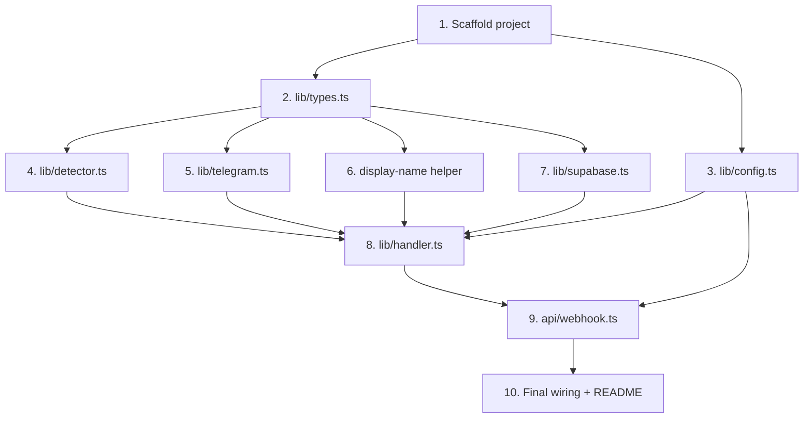

# Implementation Plan

## Overview

This plan builds the Telegram Account Relay Bot as a single Vercel Serverless Function in TypeScript, bottom-up and test-driven: scaffolding and shared types first, then the independently testable library modules (config, detector, telegram wrapper, display-name helper, supabase logger), then the orchestration handler, then the webhook entry point, and finally integration wiring plus the README with operational setup notes.

## Task Dependency Graph



```json
{
  "waves": [
    { "wave": 1, "tasks": ["1"] },
    { "wave": 2, "tasks": ["2", "3"] },
    { "wave": 3, "tasks": ["4", "5", "6", "7"] },
    { "wave": 4, "tasks": ["8"] },
    { "wave": 5, "tasks": ["9"] },
    { "wave": 6, "tasks": ["10"] }
  ]
}
```

## Tasks

- [ ] 1. Scaffold project and tooling
  - Create `package.json` as an ES module project (`"type": "module"`) with `test` script wired to vitest.
  - Create `tsconfig.json` targeting modern Node with `module`/`moduleResolution` set for ESM and `strict` enabled.
  - Create `vercel.json` (or equivalent config) so `api/webhook.ts` is served as a serverless function.
  - Create `vitest.config.ts` for the test runner.
  - Create `.env.example` enumerating `BOT_TOKEN`, `SUPABASE_URL`, `SUPABASE_KEY`.
  - Create `.gitignore` excluding `node_modules`, `.env`, and build output.
  - Install dependencies: `@supabase/supabase-js`; dev dependencies: `vitest`, `@vercel/node`, `typescript`.
  - _Requirements: 8.2, 9.1_

- [ ] 2. Define shared types in `lib/types.ts`
  - Add the Telegram subset types: `TelegramUser`, `TelegramChat`, `TelegramMessage`, `TelegramUpdate`.
  - Add the `LogStatus` union (`"Đã gửi Inbox" | "Lỗi chưa start bot" | "Đã thu hồi"`) keeping the Vietnamese strings exact.
  - Add the `LogRecord` interface with all `bot_account_logs` columns.
  - _Requirements: 7, 9_

- [ ] 3. Implement environment configuration in `lib/config.ts`
  - Define the `Config` interface and `loadConfig()` reading `process.env.BOT_TOKEN`, `process.env.SUPABASE_URL`, `process.env.SUPABASE_KEY`.
  - Throw a descriptive error naming the first missing/empty variable.
  - Write unit tests: all vars present returns a `Config`; each missing var throws naming that var.
  - _Requirements: 8.1, 8.3_

- [ ] 4. Implement sensitive-content detection in `lib/detector.ts`
  - Implement `isSensitive(text)` with keyword normalization (NFD, strip combining marks, lowercase) and word-boundary-aware `tk`/`mk` matching plus `tai khoan`/`mat khau` and colon variants.
  - Implement the numeric rule: strip spaces/dashes/dots, then match a run of 8+ digits.
  - Write unit tests covering keyword variants (case/diacritic/colon), separated 8+ digit numbers, and negatives (7-digit numbers, ordinary text, incidental t/k or m/k letters).
  - _Requirements: 3.1, 3.2, 3.3_

- [ ] 5. Implement the Telegram wrapper in `lib/telegram.ts`
  - Implement `createTelegramClient(botToken)` exposing `sendMessage` and `deleteMessage` over native `fetch`.
  - Classify responses into `SendResult` / `DeleteResult`, setting `forbidden: true` on `error_code: 403`.
  - Implement `withTimeout(p, ms)` rejecting with a timeout error, and `deleteWithRetry(client, chatId, messageId, attempts = 3)`.
  - Write unit tests with `fetch` mocked: success send, 403 send, non-403 failure, timeout, delete success/failure, and that retries stop at 3 attempts.
  - _Requirements: 2.1, 2.2, 2.4, 4.1, 4.5_

- [ ] 6. Implement the display-name / field-mapping helper
  - Implement `displayName(user)` returning first+last when present, else `username`, else `""`.
  - Implement the `LogRecord` field-mapping helper deriving all fields from `message` and `reply_to_message` (including `created_at` ISO UTC from Unix seconds and empty-string `request_content`).
  - Write unit tests: first+last, first only, username fallback, empty/missing reply text, and `created_at` conversion.
  - _Requirements: 7.1, 7.2, 7.3, 7.4, 7.5, 7.6_

- [ ] 7. Implement the Supabase logger in `lib/supabase.ts`
  - Implement `getClient(url, key)` and `insertLog(client, record)` performing a single `insert` into `bot_account_logs`.
  - Make `insertLog` non-throwing: resolve `{ ok: false, error }` on failure so logging never derails processing. Run no migrations.
  - Write unit tests with the client mocked: successful insert returns `{ ok: true }`; a rejected/errored insert returns `{ ok: false }` without throwing.
  - _Requirements: 7, 9.3_

- [ ] 8. Implement the core orchestration in `lib/handler.ts`
  - Implement `handleUpdate(update, deps)` with injected Telegram and Supabase clients.
  - Branch: private `/start` acknowledgement; group non-reply ignore; non-sensitive reply ignore; sensitive reply relay flow (send-first with 10s timeout, delete-after-success, log, confirmation line).
  - Implement the 403/timeout security path (delete first, log `"Lỗi chưa start bot"`, post ⚠️ warning), the non-403 retain path, and delete-retry exhaustion logging. Keep all Vietnamese strings exact.
  - Write branch tests with mocked deps asserting call order and exact strings: happy path, 403, timeout, non-403, delete-retry exhaustion, non-reply, non-sensitive, `/start`.
  - _Requirements: 1, 2, 3, 4, 5, 6, 7, 10_

- [ ] 9. Implement the entry point in `api/webhook.ts`
  - Parse the request body as a Telegram `Update`, call `loadConfig()`, and build `Deps` (Telegram + Supabase clients).
  - Call `handleUpdate` and always return HTTP 200 for handled message-processing outcomes; return 500 only on a config error from `loadConfig()`.
  - Write tests with the handler and config mocked: valid update returns 200; missing-config path returns 500.
  - _Requirements: 8.3, 9.1, 9.2, 10.2_

- [ ] 10. Final wiring, integration test, and README
  - Add an end-to-end integration test exercising `api/webhook.ts` with mocked Telegram/Supabase for the happy path and the 403 path.
  - Write `README.md` with setup notes: `setWebhook` registration, BotFather privacy-mode disable, granting the bot the group "Delete messages" admin right, QLL `/start` once, setting env vars on Vercel, and the reference SQL for `bot_account_logs`.
  - _Requirements: 8.2, 9_

## Notes

Setup notes (NOT coding tasks — operational steps documented in the design): registering the Telegram webhook with `setWebhook`, disabling BotFather group privacy mode, granting the bot the group "Delete messages" admin right, having the QLL send `/start` once, provisioning env vars on Vercel, and creating/verifying the `bot_account_logs` table with the reference SQL. These are performed by the user and are described in `design.md`.
